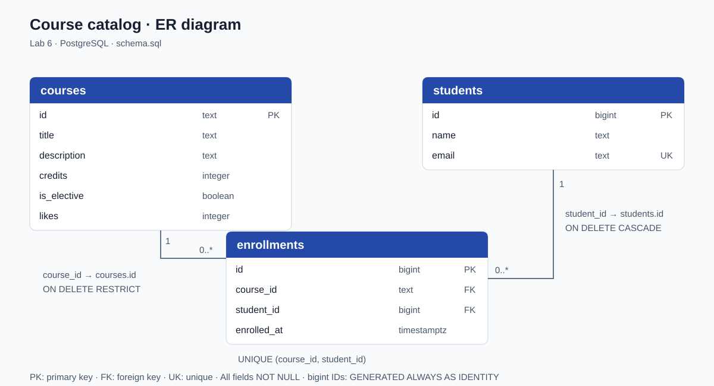

# course-catalog-db

Лабораторная №6: PostgreSQL Database Schema. Frontend `course-catalog` и backend `course-catalog-api` не изменяются: подключение SQLAlchemy относится к следующей лабораторной.

## How to run

Нужны PostgreSQL 16+ и psql. На этом Mac клиент найден по пути `/Applications/pgAdmin 4.app/Contents/SharedSupport/psql`; можно добавить эту папку в PATH.

Один раз в psql от суперпользователя (`psql postgres` на macOS):

```sql
CREATE ROLE catalog_app LOGIN PASSWORD 'change-me';
CREATE DATABASE course_catalog OWNER catalog_app;
CREATE DATABASE idx_demo OWNER catalog_app;
CREATE DATABASE norm_demo OWNER catalog_app;
```

Из каталога проекта:

```bash
psql -h localhost -U catalog_app -d course_catalog -v ON_ERROR_STOP=1 -f schema.sql
psql -h localhost -U catalog_app -d course_catalog -v ON_ERROR_STOP=1 -f seed.sql
psql -h localhost -U catalog_app -d course_catalog -v ON_ERROR_STOP=1 -f queries.sql
```

`change-me` — учебный пароль. `schema.sql` удаляет старые таблицы вместе с данными; повторный чистый запуск: schema → seed → queries. seed рассчитан на пустые таблицы; повторный запуск должен нарушить уникальность. Транзакция seed предотвращает частичную загрузку.

Проверка:

```sql
SELECT current_database(), current_user;
SHOW server_version;
\dt
\d courses
\d students
\d enrollments
SELECT (SELECT count(*) FROM courses) AS courses,
       (SELECT count(*) FROM students) AS students,
       (SELECT count(*) FROM enrollments) AS enrollments;
```

Ожидается 6 / 3 / 6, два элективных курса, студенты 1, 2, 3. После `queries.sql` api-design по-прежнему имеет 11 лайков. Identity может иметь пропуски: nextval не откатывается.

## Schema



[Открыть диаграмму отдельно](er-diagram.svg) · [Исходник Mermaid](er-diagram.mmd)

Курсы и студенты хранятся независимо. enrollments связывает их отношением многие-ко-многим через две связи один-ко-многим. Составная уникальность `(course_id, student_id)` запрещает повторную запись на один курс.

## Design decisions

1. `courses.id` — текстовый slug: совпадает с URL и данными прежнего API, читается человеком; длиннее числа и сложнее переименовывается. `students.id` — bigint identity: стабильный компактный ключ, независимый от имени/email, но сам по себе не объясняет, кто студент.
2. `RESTRICT` сохраняет курс, пока на него есть записи. `CASCADE` удаляет записи удалённого студента автоматически, не затрагивая курсы.
3. `timestamptz` хранит момент времени и отображает его в часовом поясе сессии; исходное название пояса не сохраняется. `timestamp` не определяет однозначный момент между поясами. `text` не вводит произвольный лимит длины; нужные бизнес-правила задаются CHECK.

## Constraint violation log

Команды: `psql -h localhost -U catalog_app -d course_catalog -f experiments/constraints.sql`. Файл намеренно продолжает работу после ошибок и включает `\set VERBOSITY verbose`. Ниже — фактически подтверждённые коды PostgreSQL 18.6; полная диагностика сохранена в [experiments/constraints.log](experiments/constraints.log). Для PostgreSQL 16–17 отдельно указано отличие RESTRICT.

| # | Нарушение | SQLSTATE | Constraint / column | API response |
|---|---|---|---|---|
| 1 | NULL title | 23502 | courses.title (COLUMN NAME) | 422; 500, если пропустила валидация кода |
| 2 | credits = 0 | 23514 | courses_credits_check | 422 |
| 3 | likes = -1 | 23514 | courses_likes_check | 500: счётчик меняет наш код |
| 4 | Имя из одной буквы | 23514 | students_name_check | 422 |
| 5 | Повтор email | 23505 | students_email_key | 409 |
| 6 | Повтор course id | 23505 | courses_pkey | 409 |
| 7 | Повтор пары курс/студент | 23505 | enrollments_course_id_student_id_key | 409 |
| 8 | Несуществующий курс | 23503 | enrollments_course_id_fkey | 404 |
| 9 | Несуществующий студент | 23503 | enrollments_student_id_fkey | 404: student not found |
| 10 | Удаление курса с записями | 23001 (18), 23503 (16–17) | enrollments_course_id_fkey | 409 |
| 11 | Удаление Daniyar | успех | enrollments_student_id_fkey: CASCADE | 6 → 3, после ROLLBACK снова 6 |
| + | Ручной identity id | 428C9 | students.id GENERATED ALWAYS | 500 |

HTTP здесь — проектируемое поведение будущего API, а не ответы изменённого backend. Ошибки определяются по SQLSTATE и полям диагностики, а не по тексту сообщения.

Pydantic даёт клиенту понятный ранний ответ, но к БД обращаются также SQL-консоль, импорт, другие сервисы и скрипты. Поэтому ограничения БД защищают целостность независимо от пути записи; валидация в API не заменяет CHECK/UNIQUE/FK.

## Index: EXPLAIN before and after

Запуск: `psql -h localhost -U catalog_app -d idx_demo -v ON_ERROR_STOP=1 -f experiments/index.sql > experiments/index.log 2>&1`.
Сценарий защищён проверкой имени БД, пересоздаёт схему только в idx_demo, временно удаляет итоговый индекс для честного сравнения, загружает 500 / 20000 / 50000 строк и делает по три замера до и после.

Запрос: `SELECT * FROM enrollments WHERE student_id = 777;`.

| Показатель | До индекса (замер) | После индекса (замер) |
|---|---|---|
| Access method | Seq Scan | Bitmap Heap Scan + Bitmap Index Scan |
| cost | 0.00..1042.00 | 4.31..15.59 |
| Rows Removed by Filter | 49997 | отсутствует: выборка через индекс |
| Execution Time | 1.376 ms (1.651, 1.389, 1.376) | 0.008 ms (0.040, 0.008, 0.013) |

Фактические планы PostgreSQL 18.6 (полные EXPLAIN ANALYZE в [experiments/index.log](experiments/index.log)):

```text
Seq Scan on enrollments  (cost=0.00..1042.00 rows=3 width=34)
  Filter: (student_id = 777)
```

```text
Bitmap Heap Scan on enrollments  (cost=4.31..15.59 rows=3 width=34)
  Recheck Cond: (student_id = 777)
  -> Bitmap Index Scan on enrollments_student_id_idx  (cost=0.00..4.31 rows=3 width=0)
       Index Cond: (student_id = 777)
```

1. UNIQUE(email) автоматически создаёт индекс; UNIQUE(course_id, student_id) помогает искать по первому столбцу course_id. Сам FOREIGN KEY индекс не создаёт. Поиск только по student_id в данном эксперименте требует отдельного индекса (конкретное решение всегда принимает планировщик).
2. На шести строках Seq Scan может стоить дешевле обращения к индексу; на 50000 строках при выборе трёх строк индекс сокращает чтение. Проверка малой таблицы: `ANALYZE courses; EXPLAIN SELECT * FROM courses WHERE id = 'api-design';` в course_catalog.
3. Индекс ускоряет получение записей одного студента и поиск дочерних записей при каскадном удалении студента. Цена — дополнительное место и обслуживание при изменении данных; размер выводит сценарий.

## Transaction

Ошибка второй вставки: `psql -h localhost -U catalog_app -d course_catalog -f experiments/transaction.sql`.
Ожидается: первый INSERT успешен, второй даёт 23503, SELECT внутри аварийной транзакции — 25P02. После ROLLBACK count Madina равен 0: отменён и первый INSERT. Без общей транзакции студент сохранился бы без записи на курс.

Успешный сценарий: открыть два psql, подключённых к course_catalog как catalog_app. В окне A:

```sql
BEGIN;
INSERT INTO students (name,email) VALUES ('Madina Ospanova','madina@example.com');
INSERT INTO enrollments (course_id,student_id)
SELECT 'web-security',id FROM students WHERE email = 'madina@example.com';
```

В окне B до COMMIT:

```sql
SELECT count(*) FROM students WHERE email = 'madina@example.com';
```

Ожидается 0. Выполнить `COMMIT;` в A, повторить SELECT в B: ожидается 1. Две вставки становятся видимы вместе. Проверить:

```sql
SELECT s.name,c.title FROM enrollments e
JOIN students s ON s.id=e.student_id JOIN courses c ON c.id=e.course_id
WHERE s.email='madina@example.com';
SHOW default_transaction_isolation;
```

Ожидается Madina Ospanova / Web Security Essentials, изоляция `read committed`, всего 4 студента и 7 записей. Пока A не завершена, B не видит её изменений. Держать транзакции короткими: они удерживают блокировки. Перед повторным запуском schema.sql завершить транзакции в обоих окнах.

Фактически проверено двумя независимыми соединениями: B до COMMIT = 0, после COMMIT = 1, итоговые счётчики 4 / 7. Журнал: [experiments/transaction.log](experiments/transaction.log). Затем основные данные пересозданы до 6 / 3 / 6.

## Self-review against the checklist

| Критерий | Результат проверки структуры |
|---|---|
| Keys | Да: PK во всех трёх таблицах; обе связи защищены FK |
| Types | Да: slug text, identity bigint, счётчики integer, boolean, timestamptz |
| Required values | Да: все прикладные поля NOT NULL; PK/identity также не допускают NULL |
| Constraints | Да: credits > 0, likes >= 0, имя >= 2 символов, уникальные email и пара; правило имени согласовано с Pydantic |
| Deletion | Да: courses RESTRICT, students CASCADE; сценарии подготовлены |
| Normalization | Да: сведения о курсе/студенте не повторяются в enrollments; значения атомарны |
| Indexes and names | Да: PK/UNIQUE создают индексы; course_id покрыт первым столбцом пары, student_id отдельным индексом; snake_case |

## Bonus

В queries.sql добавлены запросы 7 и 8 (бонус №4). Ожидаемые результаты: api-design, databases-postgresql, web-security; Daniyar — 3 курса, Aigerim — 2. Остальные бонусы необязательны и не заявлены выполненными.

## Сдача

Это отдельный локальный git-репозиторий, изменения фиксируются по этапам (минимум 6 коммитов). Для сдачи создать пустой репозиторий course-catalog-db на GitHub и выполнить:

```bash
git remote add origin https://github.com/YOUR_ACCOUNT/course-catalog-db.git
git push -u origin main
```

Ссылку передать преподавателю указанным им способом. Публикация и отправка преподавателю в этой сессии не выполнялись.

## Фактическая проверка — 29 октября 2026

Все обязательные SQL-сценарии выполнены на PostgreSQL 18.6 в отдельном контейнере `lab6-postgres`, подключение к базе — как catalog_app. Созданы course_catalog, idx_demo и norm_demo, владелец каждой — catalog_app.

- [queries.log](experiments/queries.log): все обязательные запросы и бонус 4 совпали с результатами задания.
- [constraints.log](experiments/constraints.log): 10 ожидаемых ошибок, CASCADE 6 → 3 → 6 и дополнительный код 428C9.
- [index.log](experiments/index.log): реальные планы, 3 замера до и после, таблица 3336 kB и индекс 896 kB. Минимальное время уменьшилось примерно в 172 раза; это результат данного опыта, не гарантия для любого сервера.
- [transaction.log](experiments/transaction.log): 23503, затем 25P02, откат студента и видимость COMMIT из второго соединения.
- [verification.log](experiments/verification.log): версия, роль, итоговые 6 / 3 / 6, Seq Scan на таблице из шести курсов. Финальное значение likes для api-design — 11.

Контейнер оставлен запущенным, порт хоста **55436** (не стандартный 5432). Подключение на этом компьютере:

```bash
"/Applications/pgAdmin 4.app/Contents/SharedSupport/psql" -h localhost -p 55436 -U catalog_app -d course_catalog
```

Учебный пароль catalog_app: `change-me`. Для повторения команд README на этом контейнере добавлять `-p 55436`. Остановить после работы: `docker stop lab6-postgres`; снова запустить: `docker start lab6-postgres`.

Подробное объяснение каждого этапа: [РАЗБОР.md](РАЗБОР.md). По содержимому и выполнению обязательные критерии проверены; GitHub push и передача ссылки преподавателю ещё не выполнены.

## Удобный запуск и проверка — 4 ноября 2026

Добавлены `run.sh` и `verify.sql`. Проверка выполнена на PostgreSQL 18.6
в отдельной базе `lab6_verify_20261104`; основная `course_catalog` не пересоздавалась.
Журнал: [verification-2026-11-04.log](experiments/verification-2026-11-04.log).
Проверены schema → seed → queries → verify → constraints → transaction → verify.
Ошибки внутри constraints/transaction ожидаемы по заданию.

На этом Mac из папки `course-catalog-db`:

```bash
export PSQL_BIN="/Applications/pgAdmin 4.app/Contents/SharedSupport/psql"
export PGHOST=localhost
export PGPORT=55436
export PGUSER=catalog_app
export PGDATABASE=course_catalog
bash run.sh verify
bash run.sh queries
```

При запросе пароля ввести учебный `change-me`. Для нового развёртывания сначала
создать роль и базы по разделу How to run. Если контейнер остановлен:
`docker start lab6-postgres`. При обычной локальной установке PostgreSQL
используйте её порт (обычно 5432).

Для намеренного сброса учебных данных: `bash run.sh reset`.
Команда удаляет три таблицы через schema.sql, загружает seed.sql и запускает verify.sql.
`verify` ожидает исходные данные 6/3/6 и 11 лайков api-design;
проверочные изменения строк откатываются, но identity-счётчики могут продвинуться.
